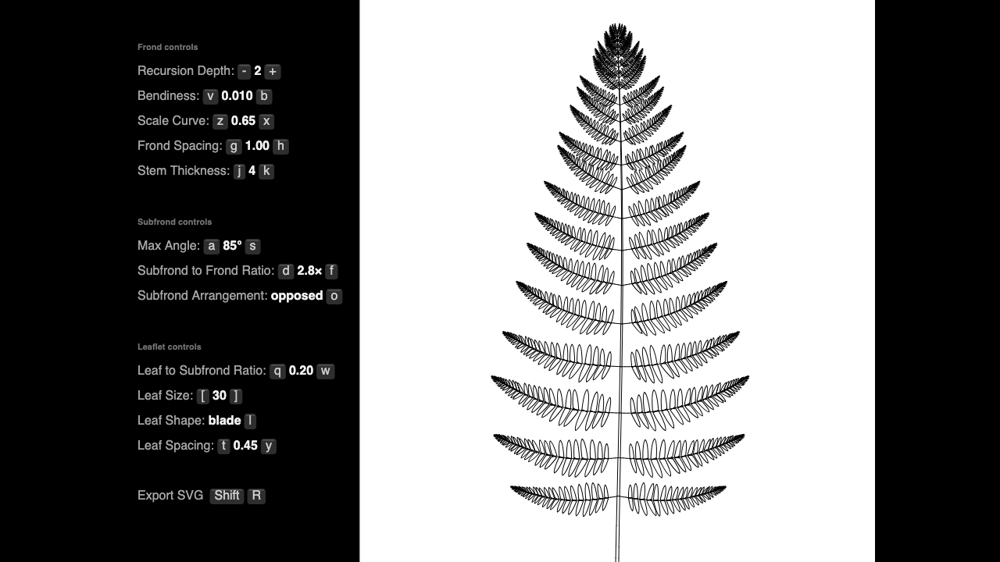

# Fern Synthesizer

A browser-based generative art sketch built in p5.js (Processing) that builds fern-like fronds with recursive branches, adjustable leaf geometry, and a handful of organic tuning controls.

Play with it here: https://summasmiff.github.io/fern-synthesizer/

## Controls

The sidebar exposes the main controls with keyboard shortcuts:

- `+` / `-`: Recursion depth
- `v` / `b`: Bendiness
- `z` / `x`: Pointiness curve
- `g` / `h`: Frond spacing
- `j` / `k`: Stem thickness
- `a` / `s`: Attachment angle
- `d` / `f`: Subfrond-to-frond ratio
- `o`: Toggle opposed/offset subfrond arrangement
- `q` / `w`: Leaf-to-subfrond ratio
- `[` / `]`: Leaf size
- `l`: Cycle leaf shape
- `t` / `y`: Leaf spacing
- `Shift + R`: Export the current fern as an SVG
